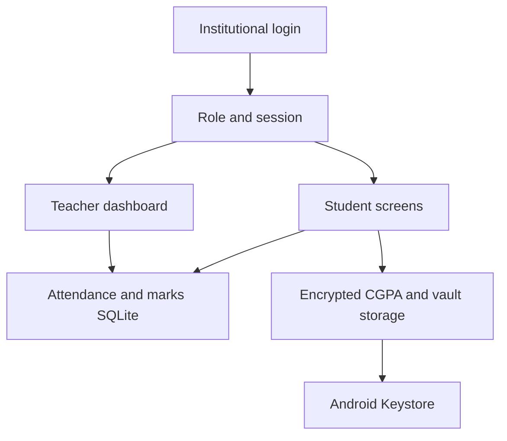

# BunkWise

BunkWise is an offline Android app for student attendance, CGPA planning, document storage, and teacher-entered marks. Teachers can record or correct attendance and marks for assigned subjects. Students see updates when they sign in on the same app installation.

## Open, sync, and build

1. Extract the ZIP and open the folder containing `settings.gradle.kts` in Android Studio.
2. Open **File → Settings → Build, Execution, Deployment → Build Tools → Gradle**. Set **Gradle JDK** to an installed JDK 21, such as `jbr-21`. If you only see Java 25, choose **Download JDK** and select version **21**.
3. Install **Android SDK Platform 36** through SDK Manager and sync. Android Studio creates the machine-specific SDK path as needed.
4. On Windows, open a terminal with `JAVA_HOME` set to the JDK 21 installation and run:

   ```powershell
   .\gradlew.bat --version
   .\gradlew.bat :app:testDebugUnitTest :app:assembleDebug
   ```

   On Linux or macOS, use `./gradlew` in place of `.\gradlew.bat`. The debug APK is written to `app/build/outputs/apk/debug/app-debug.apk`.

The project uses Gradle 8.13 and requests JDK 21 for the Gradle daemon. Keep Java 25 out of the IDE's Gradle JDK setting. If the existing setup has `org.gradle.java.home` pointing to Java 25, remove that override or update it to your JDK 21 installation. The app's Java and Kotlin bytecode targets remain at Java 11. The APK supports Android 8.0 and later.

## Demo accounts

| Role | Email | Initial password | Assigned subjects |
| --- | --- | --- | --- |
| Student | An enrolled USN followed by `@nmamit.in` | The USN, unless previously changed | Enrolled subjects |
| Teacher 1 | `teacher1@nmamit.in` | `BunkDemo12026` | SEC-RES, CLOUD |
| Teacher 2 | `teacher2@nmamit.in` | `BunkDemo22026` | CYB-FOR, SMAD-P |
| Teacher 3 | `teacher3@nmamit.in` | `BunkDemo32026` | CF-P, FIN-MGT |
| Teacher 4 | `teacher4@nmamit.in` | `BunkDemo42026` | IKS, OE |
| System admin | `admin@nmamit.in` | `smad2026` | Overview, teacher assignments, and recent audit entries |

Choose **Teacher** or **System admin** under **Account type**. Change the admin password after first sign-in. The student bootstrap login accepts both NNM and NMM aliases. The teacher accounts and assignments are demo fixtures. Use a test device or emulator for the walkthrough.

## CIE results

Security and Resilience (CB3322-1) and Cloud Computing (CS2201-1) use the supplied CIE marks matched by USN. The app preserves fractional marks, component scores, raw totals, and the final CIE scores from the sheets. The six remaining subjects use simulated CIE scores based on the distributions of the supplied sheets. Those rows are labeled **Demo marks · simulated** and use a uniform /50 format for demonstration.

Students see only their own CIE results. Teachers can view CIE results for their assigned subjects and save separate assessment entries. The admin dashboard provides read-only oversight of counts, assignments, and recent teacher changes.

## CGPA enhancement idea

Add a **What-if semester** using the existing SGPA and target planner. Let students enter or confirm credits and grade points by subject, enter projected semester-end marks once the institution's grading rules are known, and see how the projected SGPA affects their cumulative CGPA. Keep projections in the planner until students explicitly save a semester based on confirmed results. Simulated CIE and CIE-only scores should stay out of official calculations.

## Architecture



Attendance data starts from the bundled SQLite database. The app applies an idempotent schema update on older installations so the original attendance and changed passwords survive. Teacher writes and corresponding audit entries commit together. A practical class roster is filtered by lab batch. CGPA and document rows created before account ownership was introduced stay unassigned.

This is a single-device demonstration. Each installation has its own copy of the data. The app includes demonstration credentials and a bundled roster, so use a sanitized dataset before distributing it beyond the project demonstration.

## Demo script

1. Sign in as Teacher 1, choose SEC-RES, and load an August–November 2026 class. Note the date, slot, and USN of one student.
2. Change that student's status and save. Reload the roster to verify the correction.
3. Enter an IA1 mark such as 16/20 for the same student. Reopen the mark and change it to 17/20. Open **Recent changes** and show the previous and new values.
4. Log out and sign in as that student on the same device. Open **Marks** and verify 17/20. Open **Attendance** and verify the class status.
5. Open CGPA and show the SGPA and CGPA tools. Import a sample PDF into the Document Vault, then sign in as a different student to demonstrate account separation.

## Phone and emulator checks

Run `gradlew.bat :app:connectedDebugAndroidTest` on Windows or `./gradlew :app:connectedDebugAndroidTest` on Linux or macOS after connecting a test device. The repository test exercises subject authorization, mark validation and stale updates, attendance writes, repeat saves, and audit visibility. Use the checklist in [PROJECT_REPORT.md](PROJECT_REPORT.md) to record manual results. The app blocks native screenshots on its secure screens. For a project report, capture the demo on a test device with an external camera and use a sanitized roster or redact identifying details.
